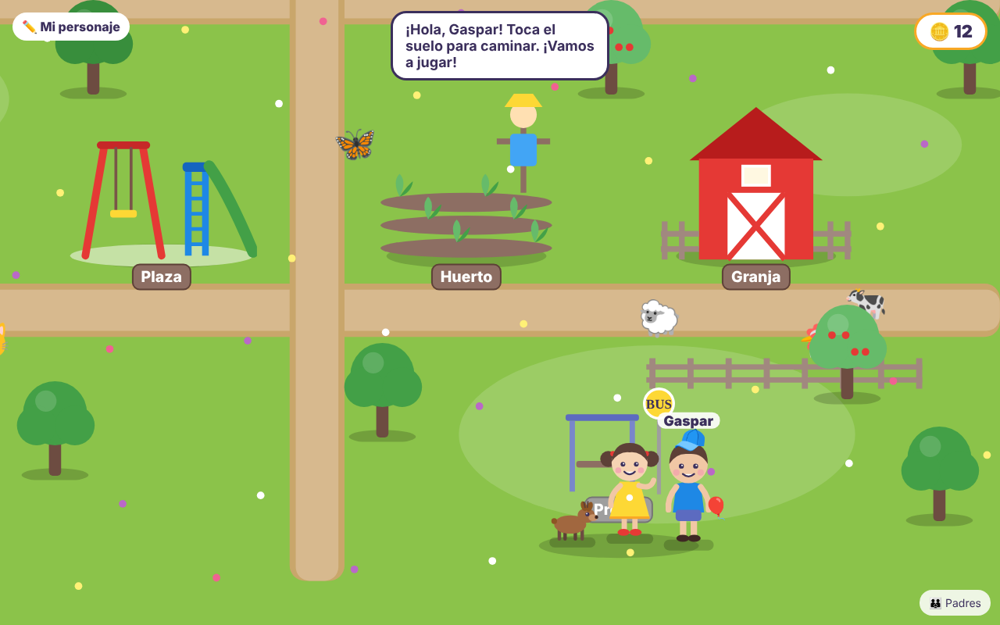
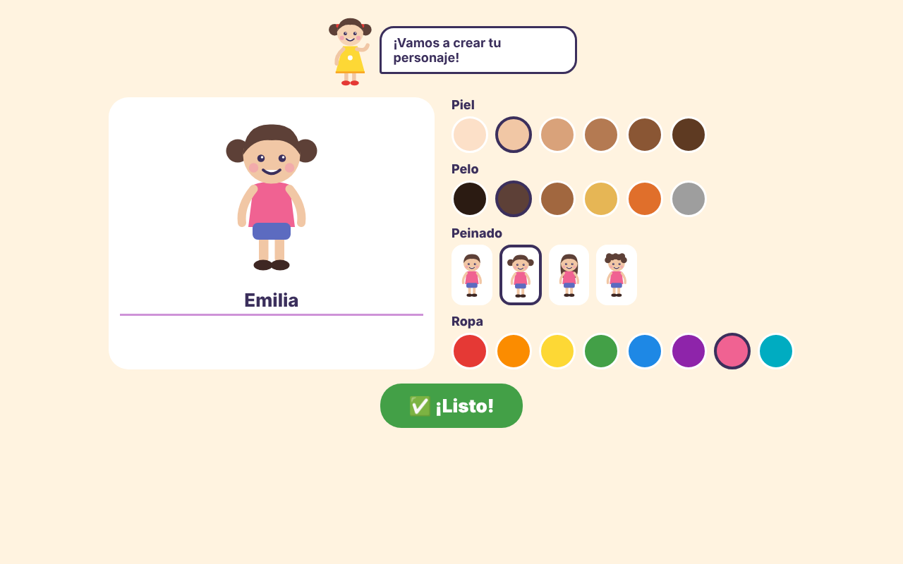
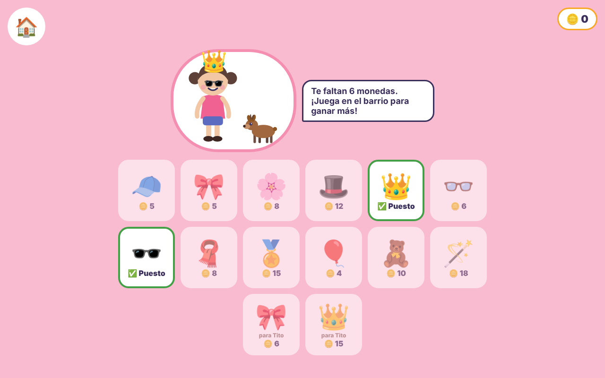
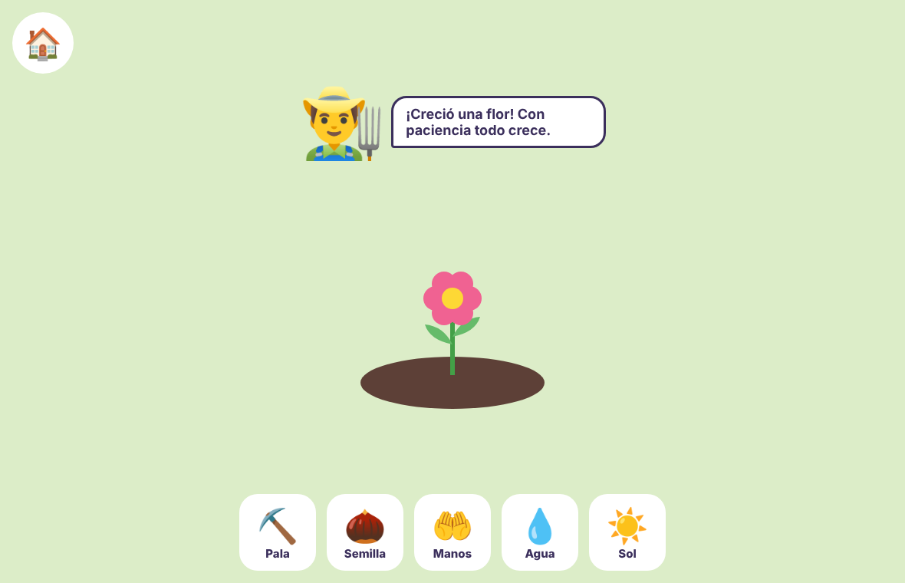
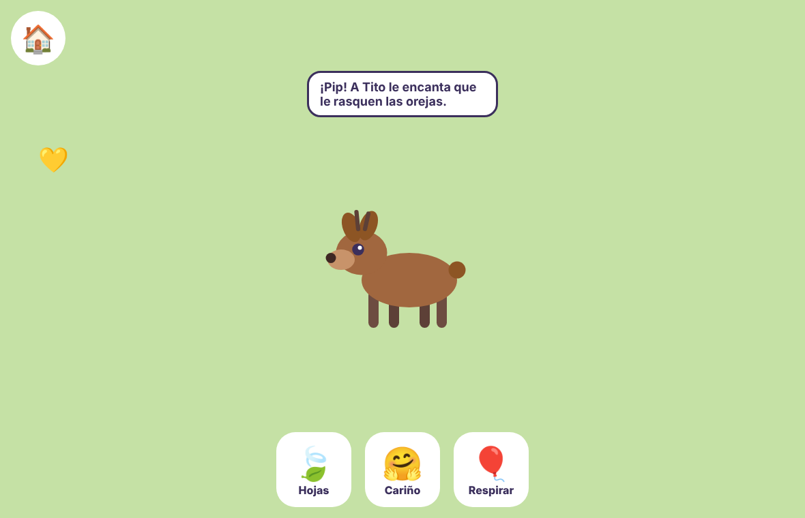
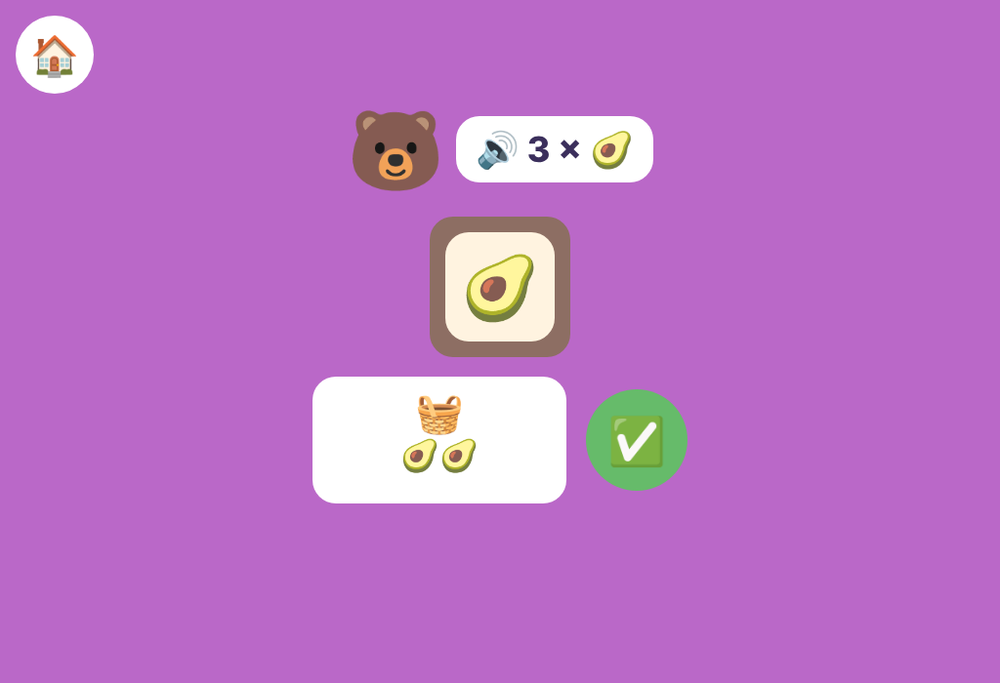

# 🎨 La Escuelita de Emilia

Juego educativo multiplataforma (iOS · Android · Web) para niños de **3 a 6 años**: pintar, letras, números, animales y sus sonidos, y juegos interactivos. 100 % en español, sin anuncios y con zona protegida para padres.



| Crear personaje | Tienda de disfraces |
|---|---|
|  |  |

| Huerto | Patio de Tito | Pintar | La Tiendita | Memoria |
|---|---|---|---|---|
|  |  |  |  |  |

## Documentación
- 🌎 [El mundo de Emilia: concepto, sesiones y experiencia del niño](docs/MUNDO_Y_EXPERIENCIA.md)
- 🌻 [Vida diaria: huerto, cuidado personal y habilidades para la vida](docs/VIDA_DIARIA.md)
- 💛 [Emilia, compañera de cada niño (lazo y conversación sin internet)](docs/EMILIA_COMPANERA.md)
- 🎭 [Guiones de los personajes](docs/GUIONES_PERSONAJES.md)
- 🎙️ [Guion de voz de Emilia](docs/GUION_EMILIA.md)
- 📚 [Guiones complementarios](docs/GUIONES_COMPLEMENTARIOS.md) · 🖨️ **Libro de guiones para imprimir y corregir:** [Word](docs/imprimible/Libro_de_guiones_La_Escuelita_de_Emilia.docx) · [PDF](docs/imprimible/Libro_de_guiones_La_Escuelita_de_Emilia.pdf) (se regenera con `tools/libro/construir.sh`)
- 🧪 [Piloto familiar](docs/PILOTO_FAMILIAR.md)
- 📊 [Estudio de producto, mercado y competencia](docs/ESTUDIO.md)
- 💼 [Plan de negocio y escalamiento a instituciones](docs/PLAN_DE_NEGOCIO.md)
- 🧑‍🏫 [Evaluación tipo educadora e informes para la familia](docs/EVALUACION.md)
- 🌍 [Idiomas por suscripción](docs/IDIOMAS.md)
- 🏗️ [Arquitectura técnica](docs/ARQUITECTURA.md)

## Estructura

```
apps/mobile        App Expo (React Native + Web): pantallas del juego
apps/api           API REST (Fastify + Zod): perfiles, intentos, resumen para padres
packages/core      Contenido (letras, números, animales) y lógica de juego compartida
supabase/          Esquema SQL con Row Level Security
```

## Empezar

Requisitos: Node 22+ y pnpm 10.

```bash
pnpm install
pnpm dev:web      # abre la app en el navegador
pnpm dev:api      # API en http://localhost:3333
pnpm test         # tests de core y api
pnpm typecheck
```

Para Android/iOS: `pnpm --filter @escuelita/mobile android` (o `ios`) con Expo Go.

## Publicar la web en Vercel

Importa este repositorio en Vercel y deja **Root Directory** en la raíz del repositorio. La configuración de [vercel.json](./vercel.json) instala las dependencias del workspace con pnpm, exporta la versión web de Expo y publica `apps/mobile/dist`. No cambies el directorio raíz a `apps/mobile`, porque la aplicación depende del paquete compartido `packages/core`.

La compilación también se puede verificar localmente con `pnpm build:web`.
