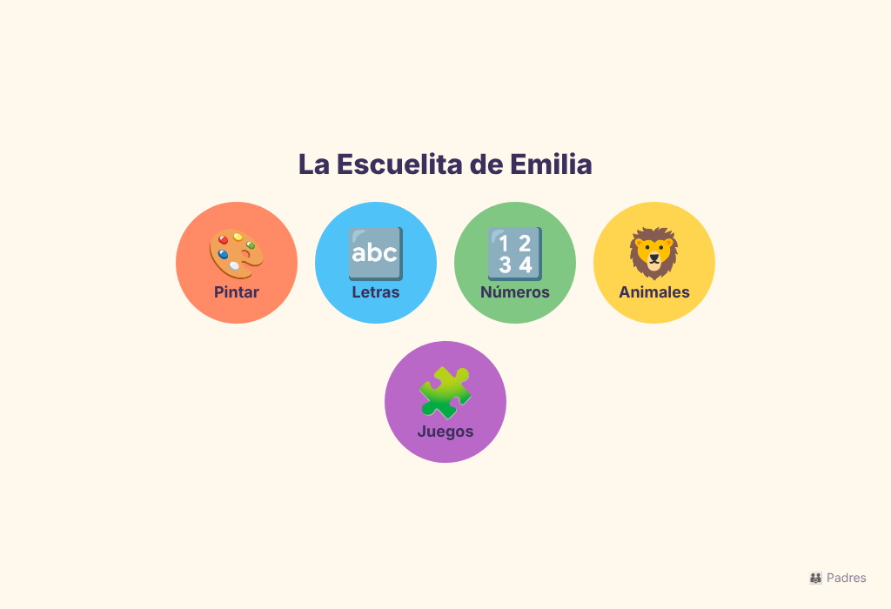
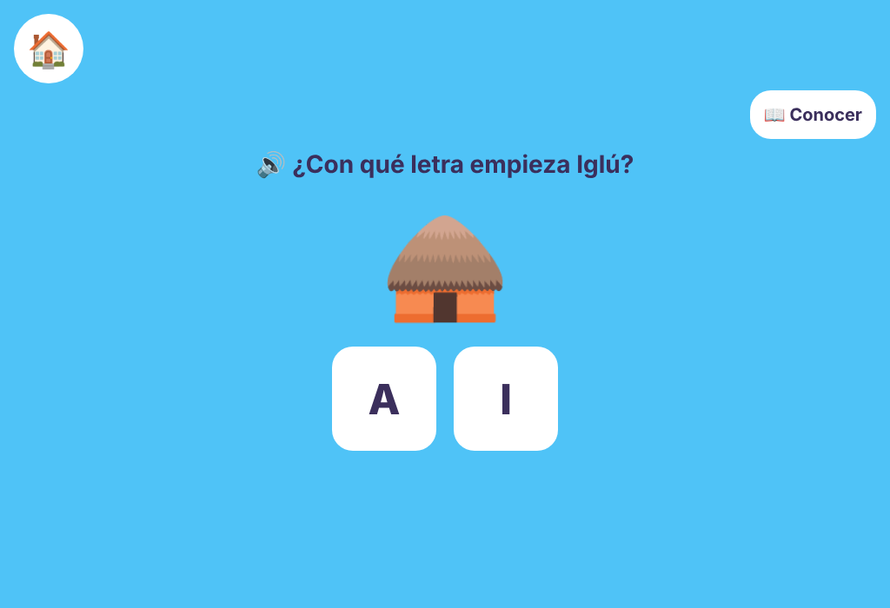
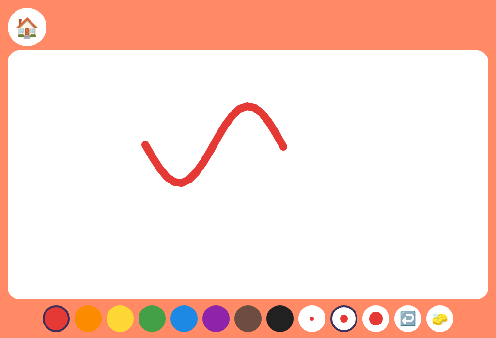
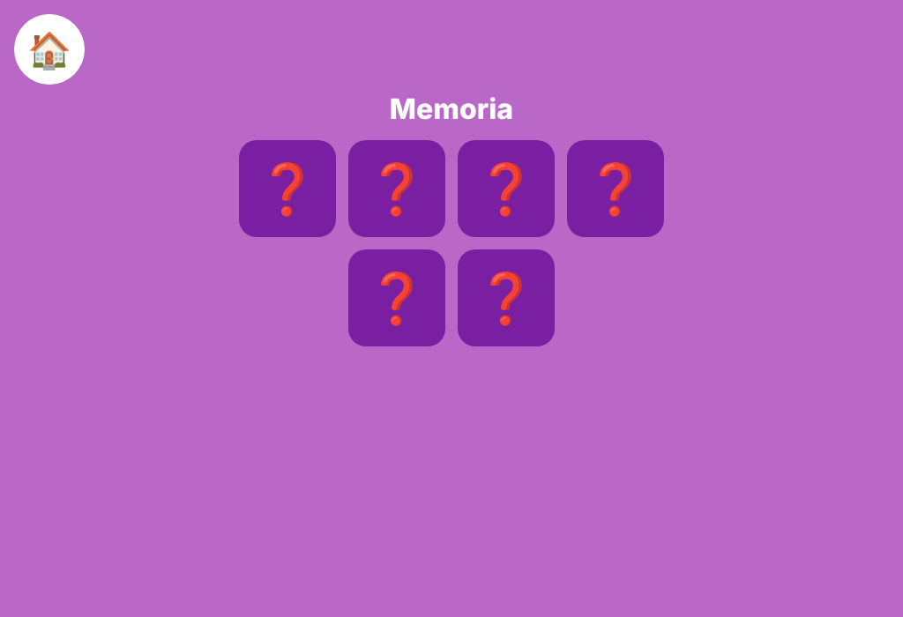

# 🎨 La Escuelita de Emilia

Juego educativo multiplataforma (iOS · Android · Web) para niños de **3 a 6 años**: pintar, letras, números, animales y sus sonidos, y juegos interactivos. 100 % en español, sin anuncios y con zona protegida para padres.

| Inicio | Letras | Pintar | Memoria |
|---|---|---|---|
|  |  |  |  |

## Documentación
- 📊 [Estudio de producto, mercado y competencia](docs/ESTUDIO.md)
- 🏗️ [Arquitectura técnica](docs/ARQUITECTURA.md)

## Estructura

```
apps/mobile        App Expo (React Native + Web): pantallas del juego
apps/api           API REST (Fastify + Zod): perfiles, intentos, resumen para padres
packages/core      Contenido (letras, números, animales) y lógica de juego compartida
supabase/          Esquema SQL con Row Level Security
```

## Empezar

Requisitos: Node 22+ y pnpm 10.

```bash
pnpm install
pnpm dev:web      # abre la app en el navegador
pnpm dev:api      # API en http://localhost:3333
pnpm test         # tests de core y api
pnpm typecheck
```

Para Android/iOS: `pnpm --filter @escuelita/mobile android` (o `ios`) con Expo Go.
